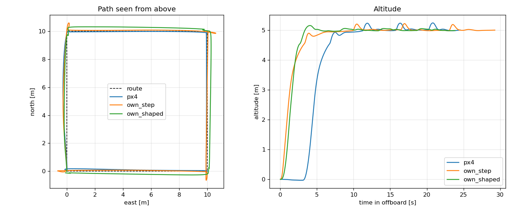

# drone-gnc-ros2

Guidance, navigation and control for a quadrotor, written in C++ on top of ROS 2 and PX4.
The vehicle flies in Gazebo through PX4 SITL; the goal is to replace PX4's own position,
attitude and rate controllers and its EKF with my own, one layer at a time, and measure
how they compare.

Work in progress.

## Layout

| Package | What it contains |
|---|---|
| `gnc_core` | Algorithms in plain C++ (no ROS): controllers, mission logic, later estimators and planners. Unit-tested with gtest. |
| `gnc_ros` | Thin ROS 2 nodes that feed PX4 data into `gnc_core` and publish setpoints back. |
| `tools` | Python scripts for flight analysis (rosbag2). |

Keeping the algorithms out of ROS means they can be tested in milliseconds, without a simulator.

## Roadmap

- [x] Simulation environment: PX4 v1.17 SITL, Gazebo Harmonic, ROS 2 Jazzy, uXRCE-DDS
- [x] Repository skeleton, CI, PID controller with anti-windup
- [x] Offboard mission state machine: arm, take off, fly waypoints, land (PX4 controllers still in the loop)
- [x] Own position/velocity controller (attitude + thrust setpoints), compared against PX4's
- [x] Reference generator (bounded acceleration) + feed-forward: corner overshoot removed
- [ ] Jerk-limited reference; explain the residual sideways excursion at corners
- [ ] Own attitude controller (body rate setpoints)
- [ ] Own EKF: IMU prediction, GPS and barometer updates, compared against PX4 EKF2
- [ ] Flight log analysis tooling (ULog / rosbag2)
- [ ] Path planning around obstacles
- [ ] Sanitizers, benchmarks and profiling in CI

## Build

Requires Ubuntu 24.04 with ROS 2 Jazzy. In a colcon workspace:

```bash
cd ~/drone_ws/src
git clone --branch release/1.17 https://github.com/PX4/px4_msgs.git
git clone https://github.com/snail398/drone-gnc-ros2.git drone_gnc
cd ~/drone_ws
colcon build --packages-up-to gnc_ros
colcon test --packages-select gnc_core && colcon test-result --verbose
```

## Run

If `MicroXRCEAgent` connects but no `/fmu` topics appear after a crashed run, stale Fast-DDS
shared memory is a likely cause: `fastdds shm clean`.

With PX4 SITL and `MicroXRCEAgent udp4 -p 8888` running, fly a 10 x 10 m square at 5 m:

```bash
ros2 launch gnc_ros mission.launch.py
```

Another mission file can be passed with `mission:=/path/to/mission.yaml`; see
`gnc_ros/config/square_mission.yaml` for the format.

The mission logic is a plain state machine in `gnc_core` (wait for pre-flight checks,
stream setpoints, switch to offboard and arm, take off, visit waypoints, land). It aborts
and leaves the vehicle to PX4 if offboard mode or arming is lost in flight. The ROS node
only converts PX4 messages to and from it, so the whole mission is covered by unit tests
against a simulated vehicle.

To just print the vehicle position: `ros2 run gnc_ros position_monitor`.

## Own position controller vs PX4

`controller:=own` replaces PX4's position and velocity loops:

```
waypoint --ReferenceGenerator--> reference position, velocity, acceleration
  --PositionController--> P on position + PID per axis on velocity + feed-forward
  --> thrust direction + collective thrust --> attitude quaternion + thrust --> PX4
```

PX4 then runs only its attitude and rate controllers. The acceleration-to-attitude step uses
the same formulation as PX4's `PositionControl` (tilt for horizontal acceleration, collective
thrust scaled by the hover thrust for vertical, tilt limit) and the gains start from PX4's
defaults.

**Reference generator** (`gnc_core/guidance`). The mission switches waypoints in one step.
Chasing that step directly made the vehicle accelerate to its speed limit and brake late,
overshooting each corner by ~0.65 m. The generator instead moves a reference towards the
waypoint with bounded acceleration (3 m/s^2) and a speed that never exceeds
`sqrt(2 * a_max * distance)`, so it always stops exactly on the waypoint. The controller
follows it with velocity and acceleration feed-forward, and the velocity PID differentiates
the error instead of the measurement (on the measurement, the D term resists the very
acceleration the reference asks for; that alone accounted for about half of the remaining
overshoot in the model).

```bash
ros2 launch gnc_ros mission.launch.py controller:=own                          # shaped
ros2 launch gnc_ros mission.launch.py controller:=own trajectory_shaping:=false # step targets
```

Same square mission in SITL (`tools/compare_flights.py`, offboard part of the flight; path
error is the horizontal distance from the route lines):

| Controller | Time | Altitude error RMS / max | Path error RMS / max |
|---|---|---|---|
| PX4 | 24.5 s | 0.09 / 0.24 m | 0.08 / 0.28 m |
| own, step targets | 29.3 s | 0.06 / 0.22 m | 0.28 / 0.66 m |
| own, shaped reference | 23.9 s | 0.04 / 0.16 m | 0.17 / 0.31 m |



With the shaped reference the corner overshoot is gone, altitude hold is the tightest of the
three and the mission is the fastest. The horizontal velocity integrator is set to 0.2
instead of PX4's 0.4: in SITL that gave 0.16 / 0.33 m path error vs 0.18 / 0.38 m (no
integrator: 0.13 / 0.26 m, but then nothing rejects a steady wind).

Open issue: after stopping at a corner the vehicle settles with a slow sideways excursion of
~0.3 m that takes a few seconds to decay, which is why the RMS path error is still twice
PX4's. Logged attitude data shows PX4 tracks the commanded tilt within ~0.25 s with no
directional bias, so the excursion comes from this controller; it appears when the
reference's braking acceleration ends abruptly (no jerk limit yet). A point-mass model with
the measured lag does not reproduce it, so the next step is a better vehicle model or
Gazebo ground truth rather than more tuning by guesswork. An attempt at a jerk-limited
reference overshot the target and was dropped.

To reproduce: record each flight (best-effort QoS overrides are in `tools/px4_qos.yaml`)

```bash
ros2 bag record -o <bag_dir> /fmu/out/vehicle_local_position_v1 /fmu/out/vehicle_status_v1     --qos-profile-overrides-path tools/px4_qos.yaml
```

then

```bash
python3 tools/compare_flights.py --mission gnc_ros/config/square_mission.yaml     --flight px4=<bag_dir> --flight own=<bag_dir> --plot comparison.png
```
