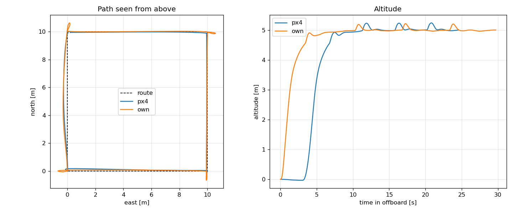

# drone-gnc-ros2

Guidance, navigation and control for a quadrotor, written in C++ on top of ROS 2 and PX4.
The vehicle flies in Gazebo through PX4 SITL; the goal is to replace PX4's own position,
attitude and rate controllers and its EKF with my own, one layer at a time, and measure
how they compare.

Work in progress.

## Layout

| Package | What it contains |
|---|---|
| `gnc_core` | Algorithms in plain C++ (no ROS): controllers, mission logic, later estimators and planners. Unit-tested with gtest. |
| `gnc_ros` | Thin ROS 2 nodes that feed PX4 data into `gnc_core` and publish setpoints back. |
| `tools` | Python scripts for flight analysis (rosbag2). |

Keeping the algorithms out of ROS means they can be tested in milliseconds, without a simulator.

## Roadmap

- [x] Simulation environment: PX4 v1.17 SITL, Gazebo Harmonic, ROS 2 Jazzy, uXRCE-DDS
- [x] Repository skeleton, CI, PID controller with anti-windup
- [x] Offboard mission state machine: arm, take off, fly waypoints, land (PX4 controllers still in the loop)
- [x] Own position/velocity controller (attitude + thrust setpoints), compared against PX4's
- [ ] Setpoint shaping to cut corner overshoot of the own controller
- [ ] Own attitude controller (body rate setpoints)
- [ ] Own EKF: IMU prediction, GPS and barometer updates, compared against PX4 EKF2
- [ ] Flight log analysis tooling (ULog / rosbag2)
- [ ] Path planning around obstacles
- [ ] Sanitizers, benchmarks and profiling in CI

## Build

Requires Ubuntu 24.04 with ROS 2 Jazzy. In a colcon workspace:

```bash
cd ~/drone_ws/src
git clone --branch release/1.17 https://github.com/PX4/px4_msgs.git
git clone https://github.com/snail398/drone-gnc-ros2.git drone_gnc
cd ~/drone_ws
colcon build --packages-up-to gnc_ros
colcon test --packages-select gnc_core && colcon test-result --verbose
```

## Run

If `MicroXRCEAgent` connects but no `/fmu` topics appear after a crashed run, stale Fast-DDS
shared memory is a likely cause: `fastdds shm clean`.

With PX4 SITL and `MicroXRCEAgent udp4 -p 8888` running, fly a 10 x 10 m square at 5 m:

```bash
ros2 launch gnc_ros mission.launch.py
```

Another mission file can be passed with `mission:=/path/to/mission.yaml`; see
`gnc_ros/config/square_mission.yaml` for the format.

The mission logic is a plain state machine in `gnc_core` (wait for pre-flight checks,
stream setpoints, switch to offboard and arm, take off, visit waypoints, land). It aborts
and leaves the vehicle to PX4 if offboard mode or arming is lost in flight. The ROS node
only converts PX4 messages to and from it, so the whole mission is covered by unit tests
against a simulated vehicle.

To just print the vehicle position: `ros2 run gnc_ros position_monitor`.

## Own position controller vs PX4

`controller:=own` replaces PX4's position and velocity loops with
`gnc_core::control::PositionController`:

```
position error --P--> velocity setpoint --PID per axis--> acceleration setpoint
  --> thrust direction + collective thrust --> attitude quaternion + thrust --> PX4
```

PX4 then runs only its attitude and rate controllers. The acceleration-to-attitude step uses
the same formulation as PX4's `PositionControl` (tilt for horizontal acceleration, collective
thrust scaled by the hover thrust for vertical, tilt limit), and the gains start from PX4's
defaults, so the comparison is about structure rather than tuning.

```bash
ros2 launch gnc_ros mission.launch.py controller:=own
```

Same square mission flown with each controller in SITL (`tools/compare_flights.py`, offboard
part of the flight only):

| Controller | Time in offboard | Altitude error RMS / max | Corner overshoot |
|---|---|---|---|
| PX4 | 24.5 s | 0.09 / 0.24 m | 0.28 m |
| own | 29.7 s | 0.07 / 0.22 m | 0.68 m |



Altitude hold is on par. At the corners the own controller overshoots more: the mission
switches the target in one step and the controller accelerates to its 5 m/s limit, while PX4
shapes the setpoint. The extra settling at each waypoint is also why the mission takes longer
even though the own controller climbs faster (PX4 spools up for ~3 s before take-off).
Setpoint shaping is the next step.

To reproduce: record each flight with
`ros2 bag record /fmu/out/vehicle_local_position_v1 /fmu/out/vehicle_status_v1` (best-effort
QoS), then

```bash
python3 tools/compare_flights.py --mission gnc_ros/config/square_mission.yaml \
    --flight px4=<bag_dir> --flight own=<bag_dir> --plot comparison.png
```
